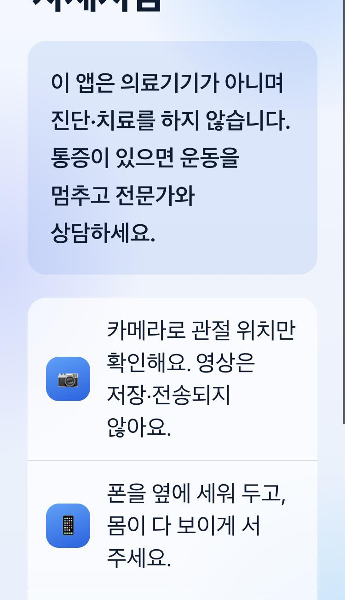
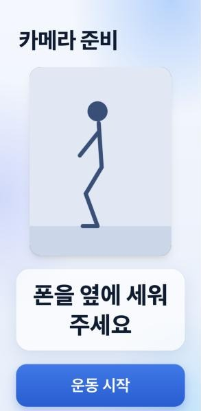
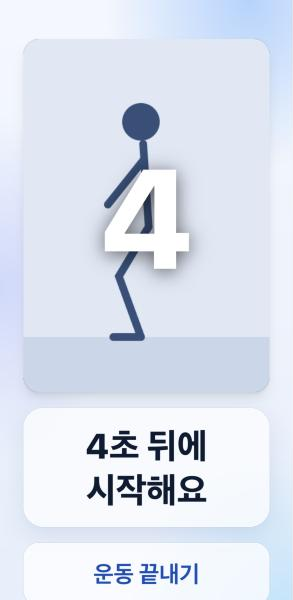

# 자세지킴

스마트폰·노트북 카메라로 **스쿼트 자세를 기기 안에서 실시간으로 분석**해, 잘못된 자세는 교정 안내를 하고 위험한 동작은 경고·중단을 안내하는 웹앱입니다. 혼자 운동하는 고령층(60대 이상)을 주 사용자로 삼았습니다.

**🔗 배포 주소: https://jase-jikim.vercel.app** (카메라가 있는 기기에서 열어 보세요. 폰은 옆에 세우고 몸 전체가 보이게 서야 합니다.)

> ⚠️ 이 앱은 의료기기가 아니며 진단·치료를 하지 않습니다. 통증이 있으면 운동을 멈추고 전문가와 상담하세요.

## 화면

| ① 시작 전 안내 | ② 카메라 준비 | ③ 운동 (5초 카운트다운) | ④ 운동 끝 |
|:---:|:---:|:---:|:---:|
|  |  |  |  |

위 캡처는 실제 사람이 아니라 **시험용 합성 영상(막대 사람)** 을 카메라 입력 대신 넣어 찍었습니다. 위험 경고(빨간 화면)는 실제 위험 자세가 필요해 캡처에 넣지 못했고, 규칙은 자동 시험으로 확인했습니다.

## 핵심 기능

- **실시간 자세 교정 안내**: 무릎이 발끝보다 앞으로 나가면 "무릎을 뒤로 빼세요"처럼 한 번에 한 문장(20자 이내)으로 알려 줍니다. 같은 안내는 3초 안에 반복하지 않습니다.
- **위험 동작 경고**: 위험한 자세가 0.3초 이상 이어지면 경고음과 함께 빨간 화면 "잠시 멈추세요"를 보여 줍니다.
- **판정을 멈추는 경우**: 몸이 다 안 보이면 "몸이 다 보이게 서 주세요", 어두우면 "밝은 곳에서 해 주세요"라고 안내하고 판정하지 않습니다.
- **사용하기 쉬운 화면**: 큰 글씨, 시작 전 의료 면책 확인, 5초 준비 카운트다운, 운동을 끝내면 축하 화면.

## 개인정보

- 카메라 영상은 **저장·녹화·서버 전송을 하지 않습니다.** 브라우저 안에서 관절 좌표만 계산하고 바로 버립니다.
- 로그인·계정·운동 기록이 없습니다.
- 카메라는 사용자가 허용한 경우에만 켜지고, 운동을 끝내거나 앱 화면이 가려지면 즉시 꺼집니다.
- 보안 헤더(CSP)로 앱의 연결을 같은 사이트로만 제한합니다. 자세 인식 라이브러리가 구글 사용 통계 서버로 기록을 보내려는 코드를 갖고 있는데, 이 설정이 그 전송을 막습니다. `npm run check:privacy`가 이 설정을 점검합니다.

## 왜 앱은 규칙 기반인가 (설계 판단)

앱 안에서는 **생성형 AI를 쓰지 않습니다.** 자세를 판정하는 일은 안전과 직결되고 같은 입력에는 항상 같은 답이 나와야 해서, 관절 좌표를 뽑는 자세 인식 모델(MediaPipe)과 공개 자료를 근거로 한 **정해진 규칙(무릎 전방 이동 비율)** 으로 판정합니다. 또 영상을 외부 AI 서비스로 보내지 않아야 개인정보를 지킬 수 있습니다. 생성형 AI는 이 앱을 **개발하는 과정**에 활용했습니다.

## 생성형 AI 활용 방법 (개발 과정)

Claude Code로 기획부터 배포까지 진행하되, 사람이 방향을 정하고 AI의 결과를 문서·시험·점검으로 검증하는 방식으로 일했습니다.

| 단계 | 활용 | 결과물 |
|---|---|---|
| 규칙 정하기 | 프로젝트 규칙서를 먼저 만들고 AI가 따르게 함: 한국어, 변경→lint·build→화면 확인→커밋의 검증 루프, 기능별 브랜치, 비밀 정보·파일 삭제 규칙 | [CLAUDE.md](CLAUDE.md) |
| 기획·계획·설계 | 계획→설계→구현→점검(PDCA) 순서로 문서를 먼저 만들고 코드와 계속 맞춤 | [PRD.md](PRD.md), [PLAN.md](PLAN.md), [DESIGN.md](DESIGN.md) |
| 설계 검토 | 설계 검증 서브에이전트로 설계서의 빠진 점·모순을 찾아 반영 | DESIGN.md 수정 이력 |
| 구현 | 기능을 작은 단위로 나눠 구현. 판정 규칙(지표 계산, 필터, 위험 판정, 안내 선택)은 자동 시험을 함께 작성 | `lib/`, 시험 58개 |
| 검증 | 자동 시험(`npm test`), 지연 시간 시뮬레이션, 서버 전송 0건 점검, 실제 브라우저에서 화면 확인 | [CHECK.md](CHECK.md) |
| 보안 점검 | 보안 전문가 에이전트로 수정 전·후 두 번 점검. 라이브러리의 숨은 통계 전송을 찾아 CSP로 차단하고 실제 브라우저에서 시도와 차단을 확인 | CHECK.md, `next.config.ts` |
| 문서 정리 | 배포 전에 기획 문서와 실제 앱의 차이를 표로 비교해 문서를 고침 | PRD.md·PLAN.md 최신본 |

AI가 낸 결과를 그대로 믿지 않은 사례: 바른 자세로 해도 지표가 크게 흔들려서(-1.40~0.47) 몸이 향한 방향을 뒤꿈치와 발끝으로 판단하고 중앙값 필터를 넣어 고쳤고, 안전 기준값은 AI가 임의로 정하지 않고 출처와 "검증 전 추정값"임을 PRD에 적었습니다.

## 기술

- Next.js 16 (App Router, TypeScript, Tailwind CSS 4), React 19
- [MediaPipe Pose Landmarker](https://developers.google.com/edge/mediapipe/solutions/vision/pose_landmarker/web_js) (`@mediapipe/tasks-vision`) — 브라우저에서 관절 좌표 추출
- Vitest (규칙 시험), Vercel (배포)

## 직접 실행해 보기

```bash
npm install
npm run dev      # http://localhost:3000
npm test         # 규칙 시험
npm run build    # 배포용 빌드
npm run check:privacy   # 서버 전송 0건 점검
```

카메라는 `https` 또는 `localhost`에서만 켜집니다. 폰에서 쓰려면 https 주소(배포본)로 접속하세요.

## 한계 (꼭 읽어 주세요)

- 주의(0.15)·위험(0.4)·밝기(60) 기준값은 공개 자료의 정성적 기준을 바탕으로 정한 **초기 추정값**이며, 실제 사람으로 검증하지 않았습니다. 안전을 보장하는 기준이 아닙니다.
- 판정 일치율·위험 경고 20회·사용 편의 시험 기록(`TEST-LOG.md`)의 수치는 **연습용 가상 기록**이며 실제 측정이 아닙니다.
- 응답 속도는 자동 시험의 시뮬레이션으로만 확인했고 실제 폰에서는 측정하지 않았습니다.
- 스쿼트(측면 촬영)만 지원합니다.

## 문서

| 문서 | 내용 |
|---|---|
| [PRD.md](PRD.md) | 서비스 기획서: 문제 정의, 목표, 기능, 범위, 보안·개인정보 |
| [PLAN.md](PLAN.md) | 계획서: 성공 기준, 작업 순서, 충족 현황 |
| [DESIGN.md](DESIGN.md) | 설계서: 화면 구성, 데이터 흐름, 파일 구조 |
| [CHECK.md](CHECK.md) | 점검 결과: 성공 기준 판정, 보안 점검 |
| [TEST-LOG.md](TEST-LOG.md) | 시험 기록지 (가상 기록 표시 있음) |
| [CLAUDE.md](CLAUDE.md) | AI 개발 작업 규칙 |
